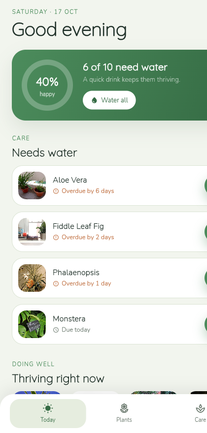

# Sprout — Plant Care Companion

A calm, organic app for managing a personal plant collection and never
forgetting to water. Built with **Flutter** and **Cubit (`flutter_bloc`)**.

<p align="center">
  
</p>

## Highlights

- **Today** view with a live hydration summary and a big *Water all* action.
- **Collection** grid with search and room filters, each card showing a
  hydration bar and due status.
- **Plant details** with species, room, light needs, watering interval and a
  care-notes card.
- **Water tracking** — one tap logs a watering, resets the schedule and adds
  to the plant’s care history.
- **Care schedule** grouped into Overdue, Today, This week and Later.
- **Add / edit / delete** plants, including choosing a photo and slider to set
  the watering interval.
- Friendly empty states and validation.

## Motion & interaction

- **Satisfying watering button** that erupts in droplets on tap.
- **Animated circular hydration gauge** that refills after watering.
- Animated **hydration bars** on cards and detail screens.
- **Hero** transitions from collection/today into the plant detail header.
- Staggered reveal for the collection grid and smooth bottom navigation.

## Architecture

```
lib/
├── main.dart                     # entry point + repository wiring
├── app.dart                      # BlocProvider + MaterialApp
├── core/                         # theme, typography, sample plants, helpers
├── data/
│   ├── models/                   # Plant (watering logic lives here)
│   └── repositories/             # SproutRepository + LocalSproutRepository
├── features/
│   ├── layout/                   # app shell + bottom navigation
│   ├── home/                     # today summary + care highlights
│   ├── plants/                   # collection, detail, form, cubit + widgets
│   └── care/                     # grouped care schedule
└── widgets/                      # ProgressRing, HydrationBar, PlantPhoto, ...
```

### State (Cubit)

`PlantsCubit` owns the collection and all care logic — CRUD, `waterPlant`
(reset schedule + log history) and `waterAllDue`. Watering helpers
(`daysUntilDue`, `hydration`, `needsWater`) live on the `Plant` model so the
UI stays declarative.

### Persistence

The collection and watering history are stored locally as JSON in
`shared_preferences` through `SproutRepository`.

## Getting started

```bash
# from the sprout/ directory
flutter pub get

flutter run -d chrome        # quick preview in the browser
flutter run                  # run on a connected phone
```

Release web build:

```bash
flutter build web --release
```

## Notes

- Plants and care data are seeded as realistic **sample data**
  (`core/sample_plants.dart`) on first launch, then persisted.
- Photography and fonts are open-licenced — see
  [`docs/ATTRIBUTIONS.md`](docs/ATTRIBUTIONS.md).

## Tech

Flutter · Dart · `flutter_bloc` (Cubit) · `equatable` · `shared_preferences`.
